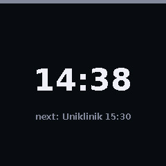
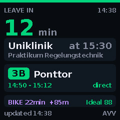
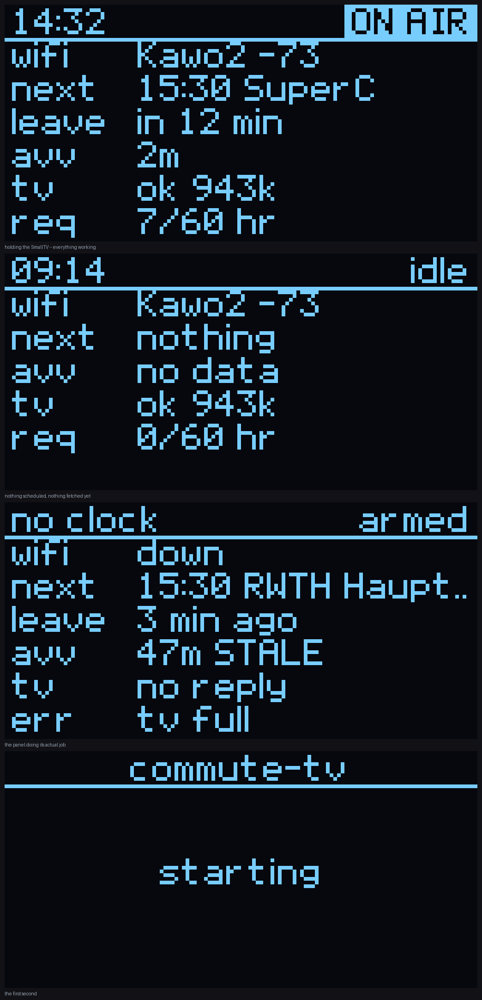

# commute-tv

An ESP32 watches your Google Calendar, works out the best way to get to your
next appointment on public transport, and puts a countdown on a shelf clock —
starting 30 minutes before you need to leave.

The clock is a **GeekMagic SmallTV Ultra running unmodified stock firmware**.
Nothing is reflashed, nothing is soldered, no warranty is voided. The ESP32
drives it entirely through the HTTP endpoints the SmallTV's own web UI uses,
over a private WiFi link the ESP32 creates for it.

| Idle | Alert |
|---|---|
|  |  |

A second, small OLED wired to the ESP32 is the health panel: WiFi, signal,
which phase the logic is in, the next appointment, the API budget, and the last
thing that went wrong. It is there so that "it isn't working" is always a
sentence with a subject.



---

## Table of contents

- [What it actually does](#what-it-actually-does)
- [Hardware](#hardware)
- [Accounts and keys you will need](#accounts-and-keys-you-will-need)
- [Setup on Linux](#setup-on-linux)
- [Setup on Windows](#setup-on-windows)
- [Configuration](#configuration)
- [Pairing the SmallTV](#pairing-the-smalltv)
- [Flashing](#flashing)
- [Reading the health panel](#reading-the-health-panel)
- [Adapting it to your city](#adapting-it-to-your-city)
- [Troubleshooting](#troubleshooting)
- [How it is built](#how-it-is-built)
- [Attribution and legal](#attribution-and-legal)
- [Licence](#licence)

---

## What it actually does

Every five minutes it asks Google Calendar for appointments in the next twelve
hours that have a non-empty `location`. For the next one, it turns that
location into a coordinate, asks the transit API for journeys that **arrive
before the appointment starts**, and picks one — preferring fewer changes over
a marginally later departure, because a direct bus you can catch beats a
two-change itinerary you cannot.

From the chosen journey it computes a leave time, backs off a safety buffer,
and 30 minutes before that it takes over the SmallTV's screen: destination,
departure and arrival, line and platform, how many changes, real-time delay,
and a countdown. It refreshes once a minute while the alert is up, because a
delay only changes what you do once you are about to leave.

Five minutes after departure it hands the screen back, restores the theme that
was there before, and deletes its own image from the device — the SmallTV keeps
every uploaded file permanently on a ~1 MB partition, so an alert that left its
frames behind would fill it in days.

It also asks openrouteservice for the cycling route and Open-Meteo for the
forecast at departure time, and scores whether cycling would be pleasant. That
part is optional and switches itself off if you leave the key blank.

**Design notes**, including why it renders JPEG in 16-row bands and why the
SmallTV never joins your main network, are in [`DESIGN.md`](DESIGN.md).

---

## Hardware

| Part | What it is | Notes |
|---|---|---|
| GeekMagic SmallTV Ultra | 240×240 ST7789 on an ESP8266, 4 MB flash | The display. **Stock firmware, never modified.** |
| ESP32 dev board | ESP32-D0WD class, 520 KB SRAM, no PSRAM needed | The brain. Anything `esp32dev` works. |
| SSD1306 OLED, 128×64, I²C | — | The health panel. Optional but strongly recommended. |
| USB power supply | 5 V, 1 A | The ESP32 runs standalone; no computer needed after flashing. |

**OLED wiring:**

| OLED | ESP32 |
|---|---|
| `VCC` | **`3V3`** — not 5 V. Its pull-ups would drive 5 V into 3.3 V GPIOs. |
| `GND` | `GND` |
| `SDA` | `GPIO21` |
| `SCL` | `GPIO22` |

If your OLED is at a different I²C address, change `oled::Config::address` in
`firmware/src/main.cpp`. The boot log tells you if nothing acknowledges.

---

## Accounts and keys you will need

Collect these before you start; each takes a few minutes.

| # | What | Cost | Used for |
|---|---|---|---|
| 1 | **Google Cloud service account** with the Calendar API enabled | free | Reading the calendar without an OAuth token that expires |
| 2 | **A transit API key** (see [Adapting it to your city](#adapting-it-to-your-city)) | usually free on request | Journeys, delays, geocoding |
| 3 | **openrouteservice API key** — [openrouteservice.org](https://openrouteservice.org) | free, 2,000/day | Cycling route and elevation. Optional. |
| 4 | Nothing for weather | — | Open-Meteo needs no key |

---

## Setup on Linux

Tested on Ubuntu 24.04. Adjust the package manager for your distribution.

### 1. Toolchain

```bash
sudo apt update
sudo apt install -y git build-essential python3 python3-pip python3-venv
```

The host build needs a C++17 compiler and `make`, and nothing else — no
Arduino, no libraries, no network. That is deliberate: the same `src/` files
compile on your laptop and on the ESP32, so a passing test is a statement about
the firmware and not about a copy of it.

### 2. PlatformIO

```bash
python3 -m pip install --user platformio
# or, if your distro protects the system Python:
python3 -m pip install --user --break-system-packages platformio
```

Make sure `~/.local/bin` is on your `PATH`, then check:

```bash
pio --version
```

### 3. Serial permissions — the step that looks like broken hardware

On Linux your user cannot open `/dev/ttyUSB0` by default, and the symptom is a
board that appears dead.

```bash
sudo usermod -a -G dialout $USER
```

**Then log out and back in** — group membership is only picked up at login.
Verify with `groups | grep dialout`.

If the board does not enumerate at all, you may need the CH340 driver; check
`dmesg | tail` right after plugging it in.

### 4. Clone and build

```bash
git clone https://github.com/YOURNAME/commute-tv.git
cd commute-tv
make test
```

You should see a few thousand assertions pass and no warnings. If that works,
your toolchain is fine and everything after this is configuration.

### 5. Python tooling

```bash
python3 -m pip install --user requests google-auth google-auth-oauthlib pillow numpy
```

`pillow` and `numpy` are only needed for the preview and JPEG-verification
tools, not for the firmware.

> ⚠️ **Do not keep this project on an NTFS partition.** The build writes
> executables, and NTFS mounts typically cannot set the executable bit. Keep it
> on ext4 or similar.

---

## Setup on Windows

Two things need building: the **firmware** (PlatformIO, works natively) and the
**host tests** (a Makefile with GCC, which does not). Pick one of two routes.

### Route A — WSL 2, recommended

You get the Linux instructions verbatim, and PlatformIO's USB access is handled
by forwarding the serial device into WSL.

1. In PowerShell as Administrator:

   ```powershell
   wsl --install -d Ubuntu
   ```

   Reboot when prompted.

2. Inside Ubuntu, follow [Setup on Linux](#setup-on-linux) exactly.

3. To flash from WSL you must attach the USB serial device. Install
   [usbipd-win](https://github.com/dorssel/usbipd-win/releases), then in
   PowerShell as Administrator:

   ```powershell
   usbipd list                  # find the BUSID of your ESP32 (CH340 / CP210x)
   usbipd bind   --busid 2-4
   usbipd attach --wsl --busid 2-4
   ```

   The board then appears in WSL as `/dev/ttyUSB0`.

**Keep the repository inside the WSL filesystem** (`~/commute-tv`), not under
`/mnt/c/`. Building across the Windows/WSL boundary is slow and the executable
bit does not survive it.

### Route B — native Windows

Firmware only; the host test suite needs a Unix-ish shell.

1. Install [Python](https://www.python.org/downloads/) (tick **Add Python to
   PATH**), then:

   ```powershell
   pip install platformio
   ```

2. Install the driver for your board's USB serial chip —
   [CH340](https://www.wch-ic.com/downloads/CH341SER_EXE.html) or
   [CP210x](https://www.silabs.com/developer-tools/usb-to-uart-bridge-vcp-drivers).
   The board appears as a `COM` port in Device Manager.

3. Build and flash:

   ```powershell
   pio run -d firmware
   pio run -t upload -d firmware
   pio device monitor -d firmware
   ```

   PlatformIO usually finds the port itself; if not, add
   `upload_port = COM5` to `firmware/platformio.ini`.

4. For `make test`, install [MSYS2](https://www.msys2.org/) and, in the MSYS2
   UCRT64 shell:

   ```bash
   pacman -S --needed mingw-w64-ucrt-x86_64-gcc make python
   make test
   ```

> The easiest sanity check on any platform: if `make test` passes, the logic is
> sound. If `pio run` succeeds, the wiring to the hardware is sound. They are
> separate questions and it helps to keep them separate.

---

## Configuration

Nothing is typed into a source file twice. `.env` is the single source of
truth, and a generator turns it into the header the firmware compiles.

### 1. Fill in `.env`

```bash
cp .env.example .env
$EDITOR .env
```

Every field is documented inline. The ones you cannot skip are the transit
access id, `HOME_LAT` / `HOME_LON`, and the Google calendar id.

> To get your home coordinates: right-click your building in Google Maps and
> click the coordinates that appear at the top of the menu — that copies them.

### 2. Google Calendar via a service account

A service account is used rather than OAuth so that nothing expires and there
is no browser flow on a headless device.

1. Create a project at [console.cloud.google.com](https://console.cloud.google.com).
2. **APIs & Services → Library →** enable **Google Calendar API**.
3. **APIs & Services → Credentials → Create credentials → Service account.**
4. On the new service account, **Keys → Add key → Create new key → JSON**.
   Save it beside the repo as `service-account.json`.
5. Point `GOOGLE_SA_KEY_PATH` at it in `.env`.

> ⚠️ **Sharing one of your own calendars with a service account does not work
> on a consumer Google account** — the permission silently fails to persist.
> The service account must *own* the calendar and share it with you.

```bash
python3 tools/make_sa_calendar.py
```

That creates a calendar owned by the service account, shares it with the
address in `GOOGLE_OWNER_EMAIL`, and prints the calendar id. Paste it into
`GOOGLE_CALENDAR_ID`. Accept the invitation in your Google Calendar sidebar,
and put appointments there — the ones with a location are the ones that count.

Check it end to end:

```bash
python3 tools/check_calendar.py
```

### 3. Validate everything

```bash
python3 tools/check_env.py          # structure and completeness
python3 tools/check_env.py --live   # actually calls each API with your keys
```

Fix anything it complains about before flashing. Debugging a key on a serial
console is much slower than debugging it here.

### 4. WiFi and the SmallTV link

```bash
cp firmware/include/secrets.h.example firmware/include/secrets.h
$EDITOR firmware/include/secrets.h
```

`WIFI_NETWORK_LIST` is **a list, in your order of preference**. One line per
network — home, phone hotspot, office. Each carries a `minRssi`: how weak that
network may get before the next one down is preferred instead. The board
surveys the air at boot and prints every network with its measured signal and
the choice it made, so if it picks something unexpected the log says why.

Ordinary WPA2 networks need `ssid` and `password`. WPA2-Enterprise (802.1X,
common on university networks) needs `ssid`, `eapUsername` and `eapPassword`,
with `password` left empty.

> ⚠️ **On an enterprise network these are usually your real account
> credentials.** The ESP32 stores them in NVS, which is not encrypted, so
> anyone holding the board can read them off the flash. Ask for a
> device-specific credential if your IT will issue one.

In the same file, set the private access point the SmallTV will join. Generate
a long passphrase — you type it into the SmallTV exactly once:

```bash
openssl rand -base64 24
```

### 5. Generate the headers

```bash
python3 tools/gen_secrets.py      # .env + service-account.json -> secrets_generated.h
python3 tools/fetch_root_ca.py    # root certificates for every HTTPS endpoint
```

`secrets_generated.h` **contains an RSA private key**. It is gitignored, and
`gen_secrets.py` sets its permissions to `600`. Never commit it; regenerate it.

`fetch_root_ca.py` reads your system certificate store and emits only the roots
that actually sign the endpoints this firmware talks to. The firmware
**refuses** unverified TLS, so without this header every request is declined —
which is the safe failure, and it says so at boot.

---

## Pairing the SmallTV

The SmallTV never joins your main network. Its `/update` endpoint is
unauthenticated — the stock binary contains the string "Unauthenticated
Update" — so on a shared network anyone could reflash it. Instead the ESP32
runs a hidden, WPA2-protected access point with **no route to the internet**,
and the SmallTV is its guest.

1. Flash the ESP32 first (below) and watch the serial log for:

   ```
   [tv] AP "your-ap-name" up on ch6, hidden, max 2 client(s)
   [tv] AP address 192.168.4.1 -- point the television here
   ```

2. On the SmallTV, hold its button to start its own setup hotspot, connect a
   phone to it, open `http://192.168.4.1`, and enter your ESP32 AP's SSID and
   passphrase. It is a hidden network, so type the name exactly.

3. The ESP32 log should then show:

   ```
   [tv] 1 client(s) on the AP
   [tv] found the television at 192.168.4.2
   ```

**Reaching the SmallTV's own web UI.** The access point admits two devices, so
you can join it from a laptop or phone and open `http://192.168.4.2`. That
network has no route out, so you lose internet on that device until you leave
it again. This is why there is a second slot: with one, there is no way to open
the SmallTV's settings at all.

**The clock.** The SmallTV fetches time over the internet, which it does not
have. So the ESP32 answers for it: it runs a small SNTP server on
`192.168.4.1`, points the SmallTV's "NTP Server Domain" setting at itself, and
reboots the device once so the setting takes effect. The weather panel cannot
be fixed this way — that comes from GeekMagic's own service — which is why the
idle theme defaults to a clock face rather than a weather face. A wrong
forecast is worse than none.

**Themes.** The device numbers them 1–7, and the idle theme is one constant,
`kIdleTheme` in `firmware/src/main.cpp`:

| | | | |
|---|---|---|---|
| 1 Weather Clock Today | 2 Weather Forecast | 3 Photo Album | 4 Time Style 1 |
| 5 Time Style 2 | 6 Time Style 3 | 7 Simple Weather Clock | |

There is no theme 0. Do not choose 3 — that is the theme the alert itself uses.

Finally, **turn off "Auto Switch Themes"** in the SmallTV's settings, or it will
cycle away from your commute alert every few seconds.

---

## Flashing

```bash
make test          # the logic
make firmware      # parses firmware/src against stub Arduino headers
pio run -t upload -d firmware
pio device monitor -d firmware
```

`make firmware` is a syntax gate, not a build: it catches a misspelled member or
a `printf` format mismatch in a second rather than after a full PlatformIO
cycle and a reflash. `pio run` is still the build that decides.

A healthy boot looks like this:

```
[oled] ok
[mem] frame buffer 32768 bytes, largest block 98292
[app] 5 known place(s); anything else is looked up
[wifi] up: 10.0.0.42
[tv] AP "commute-link" up on ch11, hidden, max 2 client(s)
[ntp] serving time to the television on 192.168.4.1:123
[time] synced, offset +120 min
[app] running
```

Once flashed the board needs no computer. Put it on a USB power supply; it
reconnects to WiFi by itself and restarts itself if the link is gone for
30 minutes.

---

## Reading the health panel

The OLED shows the phase, the next appointment, minutes to leave, WiFi and
signal, the request budget, and the most recent fault. Phases are:

| Phase | Meaning |
|---|---|
| `NoClock` | Before NTP. Nothing is decided without the time. |
| `Idle` | Nothing actionable on the calendar. |
| `Watching` | An appointment is known; the alert is not due yet. |
| `Alerting` | Holding the SmallTV's screen. |
| `Standdown` | Trying to give it back and not succeeding yet. |

The fault line shows one thing at a time, most recent and still relevant — a
queue of stale complaints is worse than the newest true one.

---

## Adapting it to your city

The transit client speaks **HAFAS ReST**, the interface behind a large number
of European public-transport APIs. This project was developed against
[AVV](https://www.avv.de/) (Aachen), whose access is granted free on request
for non-commercial use, but the client is not AVV-specific: it needs a base URL
and an access id, both in `src/hafas/hafas_request.cpp` and `.env`.

If your operator publishes a HAFAS ReST endpoint, ask them for access. Many
grant it for hobby projects. If yours does not, `src/hafas/` is the module to
replace — it is behind an interface (`app::Sources`) that the orchestrator and
its tests use, so a different provider is a new implementation of five methods
and not a rewrite.

Two things to keep whatever you use:

- **The request budget.** `AVV_MIN_INTERVAL_SEC`, `AVV_MAX_PER_HOUR` and
  `AVV_MAX_PER_DAY` in `.env` are a fuse, not a throttle: normal operation uses
  a few hundred requests a day, and these exist to stop a runaway loop before
  your provider notices it. Most agreements require exactly this.
- **The attribution.** See below.

`DEST_1`…`DEST_5` in `.env` are optional shortcuts: an exact match on a label
you type in a calendar event skips the geocoding lookup. That saves a request
and, more usefully, removes the chance of the lookup picking the wrong
similarly-named landmark.

---

## Troubleshooting

**`no reply` / `cannot reach <host>:443` in the log.** Check *which* stage
failed. A message from `ssl_client.cpp` about `errno: 104` on a socket is a TCP
reset **before any TLS** — the certificate and the API key are not involved, and
something on the network is refusing the connection. Many campus and corporate
networks block or sinkhole hosts. Test the same host with `curl` from a laptop
on the same WiFi, then from a phone hotspot; if only the hotspot works, it is
the network.

**Every HTTPS request is refused.** You have no `root_ca.h`. Run
`python3 tools/fetch_root_ca.py`. The boot log says so explicitly.

**`Double exception` boot loop.** Something large ended up on the stack. The
Arduino loop task gets 8 KB by default and this firmware raises it to 16 KB;
if you add buffers, make them members or static, not locals.

**`region dram0_0_seg overflowed`.** `dram0_0_seg` limits *statically*
allocated data — about 160 KB, far tighter than the 320 KB heap. Move the
offending buffer to a checked `malloc` at boot.

**The SmallTV shows "No images."** It is sitting on Photo Album with an album
that was emptied. The firmware recovers this by itself on the next
reassociation; to fix it now, set any other theme in its web UI.

**The SmallTV's clock is wrong and `ntp served` stays 0.** It reads its NTP
setting only at startup. The firmware reboots it once, ten minutes after it
associates, if it has asked for nothing — or power-cycle it yourself.

**WiFi will not associate on an enterprise network.** Check the log for the
disconnect reason code. Reasons 2, 20, 23, 24 and 202 are rejections (wrong
credentials); 1, 15, 16, 17, 204 and 205 are ambiguous; 200+ are usually
signal. Do not assume a weak signal is the cause because the number is large.

---

## How it is built

- **Pure logic is separated from I/O.** Everything under `src/` except the
  clients is free of hardware and network, and is tested on a laptop with a
  zero-dependency harness — a few thousand assertions at `-Wall -Wextra
  -Wpedantic -Wshadow -Wconversion`, clean under
  `-fsanitize=address,undefined`.
- **The orchestrator talks to an interface, not to the network.** Its real job
  is sequencing under failure — the transit API refuses, the calendar empties
  mid-alert, the display is unplugged while its screen is held — and those
  cases are driven through a fake rather than through hand-written JSON.
- **The 240×240 frame is never held in RAM.** 115,200 bytes does not fit; the
  largest contiguous block on this chip is about 110 KB. The renderer works in
  16-row bands and the JPEG encoder consumes them as they are produced.
- **The screen is given back on every path.** A failed release is retried
  rather than forgotten, and the leftover file is deleted, because the display
  has ~1 MB of storage and stock firmware that keeps everything.

`make` targets: `test`, `preview`, `oled`, `firmware`, `firmware-includes`,
`font`, `ca`, `secrets`.

---

## Attribution and legal

**Timetable data.** If you use an AVV endpoint, their agreement requires these
notices to be displayed with the results, and the firmware renders the first of
them on every alert screen:

> Fahrplandaten mit freundlicher Genehmigung des AVV
>
> Ergebnisangaben ohne Gewähr

Your own provider will have its own requirements. Read them; they are usually
short and specific.

**No API keys are distributed with this project.** Every key is yours, obtained
from the provider, and lives only in files this repository refuses to track.

**GeekMagic.** This project is not affiliated with, endorsed by, or supported
by GeekMagic. It drives the SmallTV Ultra through the HTTP endpoints its own
web interface uses, on unmodified stock firmware. No firmware images, manuals
or other GeekMagic material are redistributed here. If your device's firmware
version differs, the endpoints may differ; `tools/probe_smalltv.py` reports
what your device actually supports.

**Weather** is from [Open-Meteo](https://open-meteo.com/) (CC BY 4.0).
**Cycling routes and elevation** are from
[openrouteservice](https://openrouteservice.org/), built on OpenStreetMap data
© OpenStreetMap contributors.

---

## Licence

MIT — see [LICENSE](LICENSE).
